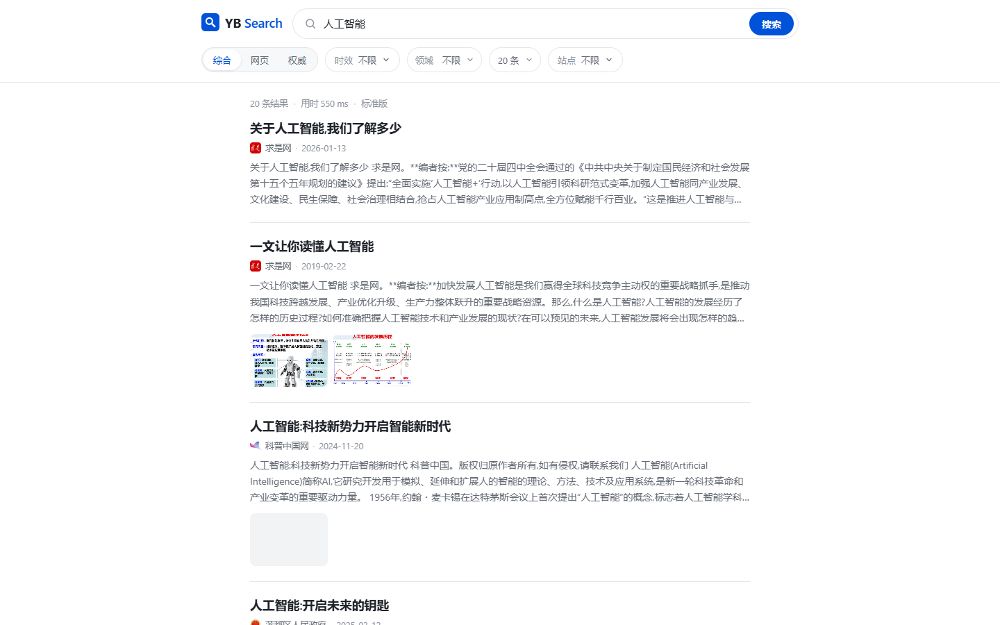
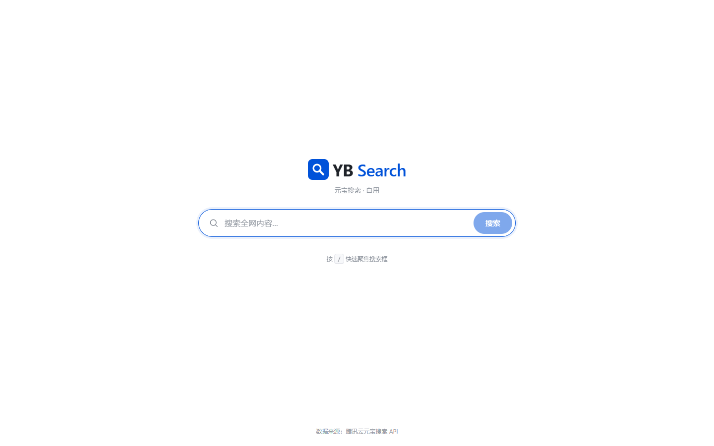
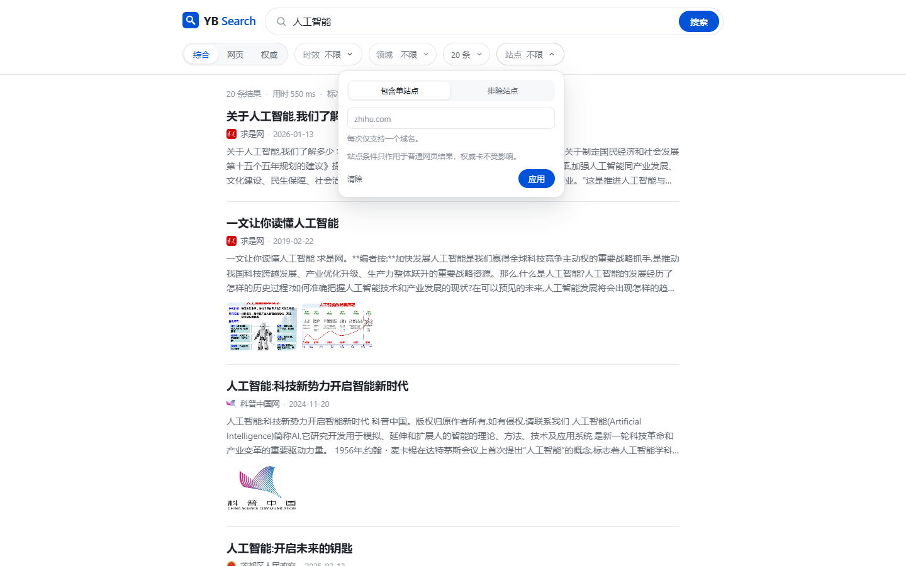

# YB Search

> 元宝搜索 · 自用 —— 基于腾讯云元宝搜索（WSA `SearchPro`）API 的私有网页搜索站。

Vue 3 + Vite 前端，Fastify 同仓代理。密钥只存在服务端，前端只访问 `/api/*`。项目按旗舰版能力设计，并按接口返回的 `Version` 自动降级。



## 功能

- 富结果卡片：标题、站点、日期、摘要、配图（最多 3 张）、favicon 兜底、权威徽标、子链
- 覆盖接口全部参数：结果类型、时效、垂直领域、返回条数、站点包含/排除（最多 5 个）、子链开关
- 时效支持快捷值、自定义相对时间、指定日期、日期区间
- 查询与筛选同步到 URL，刷新、收藏、前进后退均可还原；最近搜索存本地（最多 10 条）
- 快捷键：`/` 聚焦搜索框，`Esc` 清空并失焦
- 骨架屏、空结果、错误态（展示并复制 `RequestId`、可重试）；新查询自动取消旧请求
- ≤ 768px 移动布局，筛选收进底部抽屉
- 可选单口令登录，签名 HttpOnly Cookie，有效期 7 天
- 跟随上游版本自动隐藏不支持的能力：极速版隐藏模式/领域/条数，非旗舰隐藏权威徽标与子链

## 界面

首页：



结果页的站点高级筛选：



| 移动端结果 | 移动端筛选 |
| --- | --- |
|  |  |

启用 `SITE_PASSWORD` 后的登录页：


> 截图于 2026-10-26 实拍。当前账号为标准版，因此不显示权威徽标与子链开关。

## 快速开始

要求 Node.js 22+（推荐 24）、npm，以及已开通元宝搜索服务的腾讯云账号。

```bash
npm install
cp .env.example .env
# 编辑 .env，填入 TENCENTCLOUD_SECRET_ID / TENCENTCLOUD_SECRET_KEY

npm run dev
```

- 前端：http://localhost:5180（Vite 将 `/api` 代理到 `:3100`）
- 后端：http://127.0.0.1:3100

生产形态：

```bash
npm run build
npm start
```

打开 http://127.0.0.1:3100。服务默认监听 `127.0.0.1`，适合同机反向代理；需要直接对外监听时设置 `HOST=0.0.0.0`。

## 配置

| 变量 | 必填 | 说明 |
| --- | --- | --- |
| `TENCENTCLOUD_SECRET_ID` | 是 | 腾讯云密钥 ID，仅服务端使用 |
| `TENCENTCLOUD_SECRET_KEY` | 是 | 腾讯云密钥 Key，仅服务端使用 |
| `PORT` | 否 | 服务端口，默认 `3100` |
| `HOST` | 否 | 监听地址，默认 `127.0.0.1` |
| `SITE_PASSWORD` | 否 | 设置后启用单口令登录；留空即免登录 |
| `SESSION_SECRET` | 条件 | 启用口令时必填，用于 Cookie 签名 |
| `COOKIE_SECURE` | 否 | HTTPS 部署后设为 `true` |
| `LOG_QUERY` | 否 | 默认 `0`；设为 `1` 时日志记录查询词 |
| `LOG_LEVEL` | 否 | Fastify 日志级别，默认 `info` |

密钥在腾讯云控制台「访问管理 → API 密钥管理」获取。只写入服务端 `.env`，不要放进任何 `VITE_*` 变量；`.env` 已被 `.gitignore` 忽略。

## 脚本

| 命令 | 说明 |
| --- | --- |
| `npm run dev` | 并行启动 Fastify 与 Vite |
| `npm run dev:server` | 仅启动服务端（`tsx watch`） |
| `npm run dev:web` | 仅启动前端（Vite） |
| `npm run build` | 类型检查并构建到 `dist/` |
| `npm start` | 生产模式，单端口托管 `dist/` 与 API |
| `npm run typecheck` | 前端 + 服务端类型检查 |
| `npm test` | Vitest 纯函数单测（34 项） |
| `npm run verify:ui` | Playwright 桌面/移动端 UI 验收，截图输出到 `test-results/` |
| `npm run verify:login` | 登录/退出流程验收 |

`verify:*` 需要本机 Chrome（默认 `C:\Program Files\Google\Chrome\Application\chrome.exe`，可用 `CHROME_PATH` 覆盖）和已启动的生产服务。`verify:ui` 默认访问 `http://127.0.0.1:3100`；`verify:login` 默认访问 `http://127.0.0.1:3200`，需以 `SITE_PASSWORD` 和 `SESSION_SECRET` 启动该实例，口令默认 `verify-pass`。两者均可用 `BASE_URL`（`verify:login` 另有 `VERIFY_PASSWORD`）覆盖。

## 接口

### `POST /api/search`

```json
{
  "query": "人工智能",
  "mode": 2,
  "cnt": 20,
  "freshness": "d7",
  "industry": "news",
  "site": "exclude:qq.com|sohu.com",
  "deeplinks": true
}
```

| 字段 | 说明 |
| --- | --- |
| `query` | 必填，1–200 字符 |
| `mode` | `0` 网页 / `1` 权威 / `2` 综合（默认） |
| `site` | 单个域名表示包含；`exclude:` 前缀表示排除，最多 5 个，`\|` 分隔 |
| `cnt` | `10/20/30/40/50`，默认 `20` |
| `industry` | `gov/news/acad/finance` |
| `freshness` | `d1`–`d30`、`m1`–`m12`、`y1`–`y5`、`YYYY-MM-DD`、`YYYY-MM-DD,YYYY-MM-DD` |
| `deeplinks` | 布尔，默认 `true`，仅旗舰版生效 |

响应包含归一化后的 `results`、账号版本 `version`（`lite/standard/flagship`）、`count`、`elapsedMs`、`requestId` 与上游提示 `msg`。

其他接口：

| 接口 | 说明 |
| --- | --- |
| `GET /api/session` | 返回 `{ authRequired, authenticated }` |
| `POST /api/login` | 口令登录，设置签名 HttpOnly Cookie |
| `POST /api/logout` | 清除 Cookie |
| `GET /api/health` | 健康检查，返回 `{ ok: true }` |

错误统一为 `{ "error": { "code", "message", "requestId" } }`，上游错误码会映射为中文提示。完整设计见 [DESIGN.md](DESIGN.md)。

## 项目结构

```
server/     Fastify：鉴权、参数校验、WSA 客户端与响应解析
src/        Vue 3 前端：组件、composables、样式
shared/     前后端共享类型与参数规则
tests/      Vitest 纯函数单测
scripts/    Playwright 验收脚本
docs/       README 截图
```

## 说明与限制

- 接口无分页，单次最多 50 条；每次搜索即一次计费调用，不做联想、预取或自动刷新。
- 不自建索引、不做 AI 总结，只展示网页结果。
- 结果文本一律插值渲染（不使用 `v-html`），外链带 `noopener noreferrer`，仅接受 `http/https`。
- 公网部署时建议启用 `SITE_PASSWORD`、配置 HTTPS（`COOKIE_SECURE=true`）并增加 IP 限流。
- 更多设计与验收标准见 [DESIGN.md](DESIGN.md)，上游接口原文见 [元宝搜索.md](元宝搜索.md)。
